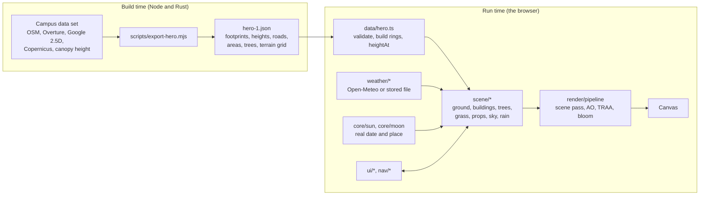

# Architecture of the next-generation viewer (apps/web)

This page explains how the new viewer is built, why it is built that way, and where to add things. It is written for a developer who has not seen the code, and for anyone judging the project who wants to know whether it is engineered or only drawn.

## Goals

1. **A pro-looking twin on a 2026 laptop.** The target is a base Apple M1 at full quality; slower machines get a lower tier automatically. The classic viewer (`campus/`) stays as the fallback for machines that cannot run WebGPU or WebGL2 well.
2. **Honest about its data.** Every building card says where the height came from and how sure the type is; everything invented (facades, species, vehicles, people) is labelled illustrative.
3. **Quality over quantity.** One hand-finished area first (the Library avenue and the old colleges), then the next. The code is organised so that a second area is a data file, not a rewrite.
4. **Infrastructure, not a demo.** Typed, linted, tested, built in CI, measured on a real GPU.

## The pipeline from data to pixels

- **Data** is exported once from the campus data set into one JSON file per hero window (`hero-1.json`, about 170 KB, 37 KB gzipped), with a version number and a validator that fails loudly on a bad file.
- **`data/hero.ts`** turns the file into typed objects: building rings with a fixed winding, a bilinear `heightAt(x, z)` over the terrain grid, trees on the ground.
- **`scene/`** turns those objects into meshes and materials. Everything is written as node (TSL) shaders, so it runs on WebGPU and, unchanged, on the WebGL2 fallback.
- **`render/pipeline.ts`** renders the scene once into colour, normal, depth and velocity targets, then adds ambient occlusion, temporal anti-aliasing and bloom before tone mapping.

## Modules

| Folder | Responsibility | Depends on |
| --- | --- | --- |
| `core/` | Pure maths that can be unit-tested in Node: geometry (rings, triangulation), sun and moon positions, clock, spatial index, seeded random numbers | nothing |
| `data/` | The hero file: types, validation, loading | `core` |
| `render/` | The renderer, the post-processing pipeline, the quality governor | three |
| `scene/` | Everything drawn. One file per thing: `ground`, `far-ground`, `buildings` + `facade-material` + `window-atlas`, `trees`, `grass`, `props` + `props-models` + `mesh-kit`, `sky`, `night-sky`, `rain`; shared helpers `noise-textures`, `tsl-noise` | `core`, `data`, three |
| `weather/` | Weather data, interpolation in time and place, easing simulation, loading with fallbacks | `core` (data and sim have no browser dependencies) |
| `nav/` | Street walking, building picking, the guided tour | `core`, `data`, three |
| `ui/` | The interface in plain DOM and CSS: time dock, weather card, building cards, help, minimap, touch stick | everything above through small interfaces |
| `main.ts` | Wires the above together and runs the loop | everything |

Rules that keep it maintainable: pure logic lives in `core/` and `weather/data.ts` and is covered by tests; `scene/` modules export a `build…` or `create…` function and nothing global; the UI never touches the scene directly, it is given callbacks.

## Performance strategy

The development laptop has an Intel UHD 600, about a tenth of a base M1, and every decision below was measured there with GPU timestamps (`#perf`).

- **Bake, do not recompute.** Procedural noise per pixel was the largest cost, so it is baked once into two small textures (`noise-textures.ts`); window and frame masks are baked into an atlas (`window-atlas.ts`); the sky and its clouds are drawn into a cube map (a face per frame, every 25 seconds or when the weather changes) instead of running the cloud shader on every pixel every frame.
- **Cull and split.** Buildings are merged per 100 m square so that frustum and shadow culling can skip districts; trees switch between a full and a light model by distance; grass is placed in the vertex shader around the camera, with nothing stored per tuft.
- **Spend pixels where they matter.** Four cascaded shadow maps of 1024 pixels give sharp shadows near the camera for a quarter of the fill cost of one 4096 map; ambient occlusion runs at half resolution.
- **Adapt.** The governor measures the real frame rate and lowers the resolution first, then the image pipeline tier, and climbs back with hysteresis. On the development laptop it settles at half resolution and the basic tier within seconds; on faster machines it stays at full quality.
- **Budgets in CI.** The application script must stay under 2 MB (600 KB gzipped); the production build is exercised in a real browser on every change.

## Lighting and time

Light is physical in spirit and tuned by eye: the real sun from the date and the place; the moon from a lunar ephemeris with its phase; about 65 catalogue stars plus a Milky Way band rotated by the local sidereal time; AgX tone mapping with an exposure that follows the sun, as a camera would adapt. The weather scales the sun, brightens the ambient light, draws clouds and an overcast layer into the baked sky, thickens the haze and darkens wet ground. The fog's far colour is read back from the baked sky so that the land meets the sky without a seam.

## Testing

- **Unit tests (Vitest, 45):** geometry, sun, moon (checked against known new and full moons), sun times, the clock, the hero data file, weather interpolation and easing.
- **End to end (Playwright):** builds the application, opens it on the WebGL2 backend in a real browser, checks the data and props loaded, the picture is not blank, the night view differs from the day view, and no console errors.
- **Real-GPU looks (`tools/dev`):** a dependency-free Chrome DevTools driver for screenshots and GPU timings on the real graphics card, because software rendering says nothing about speed.
- **Lint and types:** Biome (formatter and linter) and TypeScript in strict mode (with `noUncheckedIndexedAccess`).

## Decisions and trade-offs

- **three.js with WebGPU and node materials, not a game engine.** A downloadable engine build would mean a large download, no URL to share and a rewrite of the data pipeline. The browser keeps the project one link away from anyone, and three's WebGPU renderer falls back to WebGL2 with the same shaders.
- **Strangler migration.** The new viewer lives beside the classic one; the classic viewer keeps the whole campus and the Sandbox until the new one covers them.
- **Illustrative dressing is seeded.** Vehicles, people, lamps and tree species come from deterministic rules, so a screenshot is reproducible and a reviewer can tell data from decoration (the interface says so).
- **No UI framework yet.** The interface is plain DOM behind small interfaces; if it grows, Svelte or Preact can take over without touching the scene code.

## Where to extend

- **A second area (Hero 2):** run `npm run export:hero -- hero-2 <x> <z> 500`, add the file to `public/data`, and let the start address pick it. The loader, scene builders and tests are data-driven.
- **A new prop:** add a model to `scene/props-models.ts` (built from `mesh-kit` primitives) and a placement rule to `scene/props.ts`.
- **A new weather effect:** add it to `weather/sim.ts` as state and read it in `main.ts` where the weather is applied.
- **Sandbox overlays:** the planning engine (Rust compiled to WebAssembly) is independent of the viewer; the next step is a plan layer in `scene/` that draws proposed items and the engine's coverage grids.

## Known limits

- Nothing has been timed on an M1; the numbers in `docs/pro-plan.md` are from an integrated Intel GPU.
- Only the hero window is detailed; beyond it the land is a generic farm patchwork.
- Landmark buildings share the generic facade grammar; hand-built details need a photo survey (listed in `docs/pro-plan.md`).
- Weather is a model estimate (about 9 km), not a station reading.
