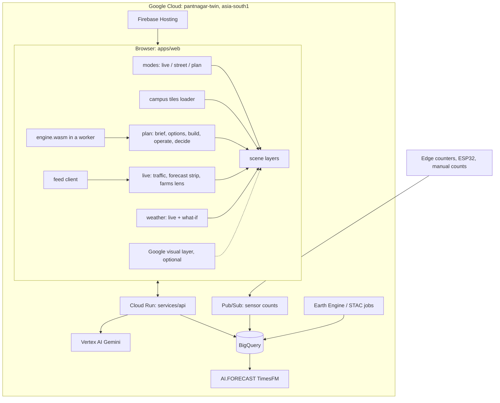

# Pantnagar Twin v3: architecture and frozen interfaces

Status: frozen for the v3 build on 13 Nov 2026. Changing an interface in section 4 needs the lead's approval and a note in `docs/decisions.md`.

This is an independent study of the GBPUAT Pantnagar campus. It is not affiliated with, commissioned by or endorsed by the university.

## 1. Where we start

| Part | What it is today | Role in v3 |
| --- | --- | --- |
| `campus/` | Three.js r160 viewer of the whole campus, with Plan mode in `campus/js/plan.js` | Legacy viewer. Keeps building. Receives only fixes. |
| `apps/web/` | WebGPU viewer (three r186, TypeScript, Vite) of one 500 m window | The v3 application. Grows to the whole campus and three modes. |
| `twin/sim/` | Deterministic Rust planning engine (Wi-Fi, lighting, access, routing, solar, rainwater, budget) | The single authority for every spatial and engineering number. Gains EV, traffic, hydrology, build sequence and finance. |
| `twin/sim-wasm/` | C-ABI WebAssembly bridge | Same engine in the browser. Gains one export per new engine call. |
| `twin/src/` | Data pipeline and CLI (`twin build`, `twin sim`, `twin sim-pack`, `twin bundle`) | Unchanged, plus `twin tiles`-style export handled by `scripts/export-tiles.mjs`. |
| `campus/data/campus-data.js` | The built campus data set: 10,845 buildings, 1,199 roads, a 5,550-node road graph, 132k tree values, terrain at 30 m, water, land use | The engineering layer. The only input to calculations. |

## 2. Target design



Principles:

1. **The engine decides, the model explains.** The AI planner never produces a number. It calls engine tools and writes text around their results.
2. **Two data layers.** The Google layer (3D tiles, satellite, Places) is visual only. The engineering layer (open data, owned sensors, user input) is the only thing the engine reads.
3. **Everything is labelled.** Every input carries a provenance tag; every live value carries a freshness time and a source class.
4. **Replay first.** Every cloud-backed feature has a committed, deterministic replay source, so the product and the demo run with no key, no sign-in and no cost.
5. **One scene, three modes.** Modes are camera and interface states over the same scene graph.

## 3. Repository layout (v3)

```
apps/web/src/
  campus/      tiled whole-campus data: index, tile loader, LOD
  modes/       mode controller, live.ts, street.ts, plan.ts, shared camera poses
  layers/      one file per drawable layer (traffic agents, plan items, build stages, flood, farms, google)
  plan/        Build-it flow: brief, options, timeline, results, compare, export
  live/        feed client, forecast strip, inspect cards, farms lens
  engine/      worker wrapper around engine.wasm, typed calls
  ai/          planner client, provider-agnostic; replay provider in the browser
  weather/     data, sim (existing) + scenarios.ts (what-if) + effects.ts
  scene/, render/, core/, nav/, ui/   existing, extended
packages/contracts/   TypeScript types and JSON Schemas shared by web, api and pipelines
services/api/         Node 24 service: planner proxy, feed ingest, forecast read; Cloud Run
pipelines/
  sensors/     edge counter client, ESP32 firmware, synthetic feed generator
  forecast/    BigQuery SQL (AI.FORECAST), backtest, local fallback
  eo/          satellite ingestion (STAC / Earth Engine), per-field indices
infra/                Terraform, firebase.json, deploy workflows, budgets
twin/sim/src/         + limits.rs, ev.rs, traffic.rs, hydro.rs, build.rs, finance.rs
scenarios/            + ev-dwpt-main-road.geojson and its pre-generated plan pack
docs/                 this file, decisions.md, google-platform.md, data-sources.md, demo-script.md, visual-audit.md
```

## 4. Frozen interfaces

### 4.1 Scenario schema v2 (backward compatible with v1)

A scenario stays a GeoJSON `FeatureCollection` with a `sandbox` member. `sandbox.version` is `1` or `2`. A v1 file is a valid v2 file. New in v2:

```jsonc
"sandbox": {
  "version": 2,
  "project": {                      // optional: set by the Build-it flow
    "id": "ev-dwpt-main-road",
    "brief": { /* Brief, 4.4 */ },
    "option": "B",                  // which option of the plan pack this scenario is
    "generated_by": { "provider": "replay|vertex|anthropic|template", "model": "", "at": "ISO time" }
  },
  "ev": {                           // EV model inputs; every value is a Quantity (4.2)
    "fleet": { "e_rickshaw": {"count": Q, "equipped_share": Q, "battery_kwh": Q, "wh_per_km": Q}, "bus": {...}, "service": {...}, "car": {...}, "two_wheeler": {...} },
    "tariff_buy": Q, "tariff_sell": Q, "utilisation": Q, "grid": { "headroom_kva": Q, "connection": Q }
  },
  "traffic": { "seed": 1, "day": "weekday|weekend|exam|holiday", "from_h": 6, "to_h": 22, "demand_scale": Q, "calibration": "none|manual|sensor" },
  "build": { "start": "2027-01-04", "phases": [ /* BuildPhase, 4.3; empty = let the engine sequence */ ] },
  "weather": { "scenario": "live|cloudburst|week_rain|fog|heatwave|hail|dust|cold_wave|replay:<date>", "storm_mm": Q }
}
```

New and extended item kinds (all in `twin/sim/src/catalog.rs`):

| kind | geometry | parameters (default) |
| --- | --- | --- |
| `ev_charger` (extended) | Point | `type` `ac` or `dc` (`ac`), `power_kw` (7.4 ac, 30 dc), `ports` (2) |
| `dwpt_road` | LineString along an existing or proposed road | `lanes` (1), `coverage` % of length with coils (60), `segment_m` coil segment length (1.65), `power_kw` per vehicle pickup (20), `efficiency` % grid-to-battery (85), `cabinet_every_m` (100) |
| `road_closure` | LineString on an existing road | `mode` `full` or `one_lane` (`one_lane`), `from_day`, `to_day` (build days) |
| `substation` | Point | `kva` (250) |
| `sensor` | Point | `type` `counter`, `wifi_sense` |

Rules: unknown keys are preserved on round trip; the engine ignores kinds it does not know and reports them in `warnings`.

### 4.2 Provenance: `Quantity`

Every model input that is not a plain geometry is a `Quantity`:

```ts
type Provenance = "measured" | "sourced" | "calculated" | "assumed" | "unknown";
interface Quantity { v: number | null; unit: string; p: Provenance; src?: string; url?: string; accessed?: string; note?: string }
```

`v: null` is only valid with `p: "unknown"`. The engine accepts a bare number as `{v, p: "assumed"}`. A result that depends on an `unknown` input is returned with `"blocked_by": [paths]` instead of a number. Every engine result object carries `inputs: {path: Provenance}` for the values it used.

### 4.3 Engine API (Rust, mirrored one-to-one in WASM and in `twin sim`)

All calls are pure and deterministic: same world, scenario and options give the same bytes. JSON in, JSON out, unless a grid or frame buffer is noted.

| Rust | WASM export | CLI | Returns |
| --- | --- | --- | --- |
| `limits::check(&Scenario) -> Result<(), String>` | (inside `plan_set`) | (inside `sim`) | error naming the limit and the feature |
| `traffic::simulate(w, ctx, &TrafficOpts) -> TrafficRun` | `plan_traffic(json) -> len` | `twin sim --traffic` | `TrafficSummary` |
| `TrafficRun::frames()` | `plan_traffic_frames() -> *const f32`, `plan_traffic_frames_len()` | `--frames out.bin` | `Float32Array`, layout below |
| `ev::evaluate(w, ctx, &TrafficRun) -> Value` | `plan_ev() -> len` | `--ev` | `EvResult` |
| `build::sequence(w, ctx) -> Value` | `plan_build() -> len` | `--build` | `BuildPlan` |
| `hydro::flood(w, ctx, &Storm) -> FloodRun` | `plan_flood(json) -> len`, `plan_flood_grid() -> *const f32` | `--flood` | `FloodSummary` + depth grid (m) |
| `finance::model(&Value) -> Value` | `plan_finance(json) -> len` | `--finance` | `FinanceResult` |
| `sites::screen(w, ctx, &Value) -> Value` | `plan_sites(json) -> len` | `--sites` | ranked `SiteCandidate[]` |

Traffic frame buffer: header `[version=1, n_agents, n_steps, dt_s, t0_s]` then `n_steps * n_agents * 4` floats `[x, z, heading_rad, state]`, `state` = `class + 10*flag` with class `0 pedestrian, 1 bicycle, 2 two_wheeler, 3 e_rickshaw, 4 car, 5 bus, 6 service` and flag `0 absent, 1 moving, 2 queued, 3 charging_dwpt, 4 charging_static`. Absent agents have `x = NaN`.

Result shapes (keys are stable; more may be added):

```ts
interface TrafficSummary { ok: true; seed: number; hours: [number, number]; agents: number; by_class: Record<string, number>;
  edges: { id: number; flow_veh_h: number; speed_kmh: number; v_c: number }[];   // peak hour
  gates: { name: string; in: number; out: number }[]; delay_veh_h: number; closures_applied: number;
  calibration: "none" | "manual" | "sensor"; label: "simulated"; inputs: Record<string, Provenance> }
interface EvResult { ok: true; options_label: string; vehicles_served_day: number; energy_kwh_day: number;
  by_class: Record<string, { served: number; kwh: number; soc_gain_pct: number }>;
  dwpt: { length_m: number; coil_m: number; cabinets: number; equipped_passes: number; kwh_day: number; avg_kw_per_pass: number } | null;
  static: { ports: number; sessions: number; kwh_day: number; utilisation_pct: number } | null;
  peak_kw: number; peak_kva: number; grid: { headroom_kva: number | null; upgrade_needed: boolean | null; blocked_by?: string[] };
  inputs: Record<string, Provenance>; warnings: string[] }
interface BuildPhase { id: string; name: string; from_day: number; to_day: number; crew: number; equipment: string[];
  geometry: GeoJSON.Geometry | null; closes: number[]; cost_share: number; p: Provenance }
interface BuildPlan { ok: true; start: string; days: number; phases: BuildPhase[]; closures: { edge: number; mode: string; from_day: number; to_day: number }[] }
interface FloodSummary { ok: true; storm_mm: number; return_period: string; max_depth_m: number; flooded_road_m: number;
  closed_edges: number[]; items_at_risk: { id: string; depth_m: number }[]; grid: { x0: number; z0: number; cell: number; nx: number; nz: number }; label: "modelled" }
interface FinanceResult { ok: true; capex: number; opex_year: number; revenue_year: number; payback_years: number | null; npv: number | null; irr_pct: number | null;
  boq: { key: string; label: string; qty: number; unit: string; rate: number; amount: number; qty_p: Provenance; rate_p: Provenance }[];
  sensitivity: { name: string; low: number | null; base: number | null; high: number | null; metric: "npv" | "payback" }[]; blocked_by?: string[]; caveats: string[] }
interface SiteCandidate { id: string; lonlat: [number, number]; score: number; confidence: "low" | "medium" | "high";
  factors: { key: string; score: number; reason: string; p: Provenance; src: string }[]; constraints: string[] }
```

Limits (one table in `limits.rs`, also exported in the catalogue as `limits`): 5,000 features; 2,000 positions per geometry; coordinates within the campus bounds plus 2 km; 4 km² per sampled polygon; 60 km total new road; traffic 20,000 agents and 16 simulated hours.

### 4.4 Planner contracts (`packages/contracts`)

```ts
type Role = "investor" | "campus_owner" | "facilities" | "consultant" | "student";
interface Brief { title: string; role: Role; request: string; goals: string[]; users: string[]; vehicle_classes: string[];
  phases: { name: string; months: number }[]; budget: Quantity; ownership: string; pricing: Record<string, Quantity>;
  constraints: string[]; open_questions: string[]; assumptions: Record<string, Quantity> }
interface PlanOption { key: "A" | "B" | "C"; title: string; summary: string; scenario: Scenario /* v2 GeoJSON */;
  results?: { evaluate: unknown; traffic: TrafficSummary; ev: EvResult; build: BuildPlan; flood?: FloodSummary; finance: FinanceResult } }
interface PlanPack { id: string; version: 1; brief: Brief; options: PlanOption[]; register: ApprovalEntry[]; surveys: SurveyItem[];
  trace: ToolCall[]; provider: "replay" | "vertex" | "anthropic" | "template"; disclaimer: string }
interface ApprovalEntry { topic: string; body: string; requirement: string; url: string | null; accessed: string | null; status: "sourced" | "requires_professional_confirmation" }
interface SurveyItem { what: string; why: string; who: string; unlocks: string[] }
interface ToolCall { tool: PlannerTool; input: unknown; output_digest: string; ms: number }
type PlannerTool = "brief.create" | "sites.screen" | "plan.propose" | "engine.evaluate" | "traffic.run" | "ev.evaluate" | "build.sequence" | "flood.run" | "finance.model" | "sources.lookup";
interface PlannerProvider { id: string; plan(request: string, role: Role, tools: ToolHost, signal: AbortSignal, onStage: (s: Stage) => void): Promise<PlanPack> }
```

The model may only emit `brief.create` and `plan.propose` content plus prose; every other tool is executed by the host against the engine and its output is passed back. `plan.propose` output is validated against the scenario JSON Schema and the limits before it is accepted; an invalid proposal is returned to the model once for repair, then rejected. Caps per run: 24 tool calls, 60 s wall time per call, 200k tokens.

HTTP (`services/api`, all JSON): `POST /v1/plan` (auth required, streams stage events as server-sent events), `GET /v1/packs/:id` (public, cached), `POST /v1/feed` (sensor key), `GET /v1/feed/latest`, `GET /v1/forecast?series=`, `GET /v1/farms/fields`, `GET /healthz`. The web app works with none of these reachable.

### 4.5 Feed and forecast contracts

```ts
interface FeedSample { sensor_id: string; t: string /* ISO, minute */; kind: "count" | "occupancy"; class?: VehicleClass; dir?: "in" | "out";
  n: number; source: "measured" | "manual" | "synthetic"; firmware?: string }      // no image, no identifier of a person, ever
interface Series { id: string; label: string; unit: string; t: string[]; v: (number | null)[]; source: FeedSample["source"] }
interface Forecast { series_id: string; t: string[]; mean: number[]; lo: number[]; hi: number[]; level: 0.8;
  model: "timesfm" | "arima_plus_xreg" | "seasonal_naive"; made_at: string; backtest: { mape: number | null; n: number }; label: "forecast" }
interface FieldRecord { id: string; ring: [number, number][]; area_ha: number; index: Series /* NDVI */; moisture?: Series;
  crop: { name: string | null; stage: string | null; confidence: number; p: "measured" | "calculated" | "unknown" }; alerts: string[]; imagery_source: string; last_pass: string }
```

The schema validator rejects any feed payload with a key outside the list above. Replay files live in `apps/web/public/replay/` with the same shapes.

### 4.6 Scene and mode API (`apps/web`)

```ts
type ModeId = "live" | "street" | "plan";
interface CameraPose { x: number; y: number; z: number; yaw: number; pitch: number; focus?: { x: number; z: number } }
interface TwinContext { gfx: Gfx; scene: THREE.Scene; camera: THREE.PerspectiveCamera; campus: Campus; clock: Clock; weather: WeatherSim;
  env: EnvUniforms; layers: LayerRegistry; bus: Bus; quality(): Quality; heightAt(x: number, z: number): number }
interface Mode { id: ModeId; enter(pose: CameraPose, ctx: TwinContext): void; exit(): CameraPose; update(dt: number): void; dispose(): void }
interface Layer { id: string; group: THREE.Object3D; setVisible(v: boolean): void; update?(dt: number, ctx: TwinContext): void; dispose(): void }
interface LayerRegistry { add(l: Layer): void; get<T extends Layer>(id: string): T | undefined; remove(id: string): void; list(): Layer[] }
interface Campus { index: CampusIndex; heightAt(x: number, z: number): number; tilesNear(x: number, z: number, r: number): Promise<Tile[]>;
  graph: { nodes: Float32Array; edges: Uint32Array }; buildingAt(x: number, z: number): Building | null }
```

Rules: a layer never reads another layer; it reads `TwinContext` and events on the bus. Only `main.ts` and `modes/` touch the camera. Tiles are 500 m squares in the engine's local frame (metres east and south of 29.0205 N, 79.4935 E), named `t_<ix>_<iz>.json`, each in the existing hero file shape, plus `index.json` (bounds, tile list, coarse terrain, road graph, named places).

Deep links: `#mode=live|street|plan&x=&z=&yaw=&pitch=&alt=&t=&wx=&plan=<pack id>&opt=A&day=<build day>&split=1`.

## 5. Data sources and terms

Recorded in full, with access dates, in `docs/data-sources.md` and `docs/google-platform.md`. Summary of the rule set:

- Engineering layer: OpenStreetMap (ODbL), Overture, Google Open Buildings (CC BY 4.0 / ODbL, a research data set that is not part of Maps Platform), Microsoft footprints, Copernicus DEM, Sentinel-1/2, Landsat/HLS, NASA FIRMS, GPM, SMAP, Open-Meteo, owned sensors, user entries.
- Google Maps Platform (Map Tiles, Places, Street View): display only, attribution on screen, no caching beyond the service terms, never an input to the engine, never a reference image for automated checks.
- Roads Management Insights: adapter only, disabled; eligibility is limited to public-sector and infrastructure managers.

## 6. Threat model

| Threat | Where | Control |
| --- | --- | --- |
| Malicious plan file or share link (crash, hang, memory) | engine, `plan.js`, web import | parser rejects malformed geometry; `limits.rs`; share links capped at 8 MB; engine in a worker with a watchdog; panics reported, never retried on the same input |
| Stored or reflected script through plan text | web UI, exports | text nodes only, no `innerHTML` with plan data; exports escape; a strict Content-Security-Policy on Hosting |
| Prompt injection through the brief or fetched pages | planner | the model cannot call side-effect tools; tool outputs are data; fetched text is quoted and length-capped; output must pass schema and limits; no secrets in the model context |
| Key exposure | Maps key, model credentials | Maps key is a referrer- and API-restricted browser key injected at deploy; model access only through the service account of `services/api`; no JSON keys; Workload Identity Federation for deploys |
| Cost abuse | `/v1/plan`, Maps | sign-in required; per-user and global daily caps in the API; Maps quotas capped in the console; budget alerts; a kill switch flag read by the API and the web app |
| Sensor privacy | feed | counts only; schema allow-list; no images or MAC addresses leave a device (hashed and salted on the device, then dropped); DPDP Act 2023 notes in `pipelines/sensors/PRIVACY.md` |
| Misleading output | everywhere | provenance labels, "concept estimate" watermark on exports, `blocked_by` instead of invented numbers, the independent-study disclaimer |

## 7. Cost model

Kept in `docs/google-platform.md` with current prices and the dates they were read. Design position: at low traffic the product should cost close to nothing outside AI calls (Hosting and Cloud Run free tiers, BigQuery on-demand under the free monthly allowance, Earth Engine non-commercial tier). Map tiles and model calls are the two metered costs, and both sit behind explicit user actions and caps.

## 8. Workstreams

| ID | Scope | Owns (write access) |
| --- | --- | --- |
| A | Engine hardening, limits, parity, CI | `twin/sim/src/{graph,limits,plan}.rs`, `twin/sim/tests/`, `.github/workflows/`, `campus/js/plan.js` (import checks only) |
| A2 | EV, DWPT, finance, site screening | `twin/sim/src/{ev,finance,sites}.rs`, catalogue entries for the new kinds |
| C | Traffic model, demand, sensors, forecast | `twin/sim/src/traffic.rs`, `pipelines/{sensors,forecast}/` |
| D | Build sequence, hydrology | `twin/sim/src/{build,hydro}.rs` |
| B | Whole-campus tiles, modes, renderer, weather | `scripts/export-tiles.mjs`, `apps/web/src/{campus,modes,layers,weather,scene,render,nav}/`, `apps/web/src/main.ts` |
| E | Planner, contracts, API | `packages/contracts/`, `services/api/`, `apps/web/src/ai/` |
| F | Cloud, hosting, deploy, terms research | `infra/`, `docs/google-platform.md`, `docs/data-sources.md` |
| H | Earth observation and farms | `pipelines/eo/`, `apps/web/src/live/farms*` |
| G | Tests, visual audit, demo | `e2e/`, `tools/audit/`, `docs/{demo-script,visual-audit}.md` |

Shared files (`twin/sim/src/{lib,engine,catalog}.rs`, `twin/sim-wasm/src/lib.rs`, `twin/src/simcli.rs`, root `package.json`) are edited only through small, clearly marked additive blocks, and the lead merges them.
